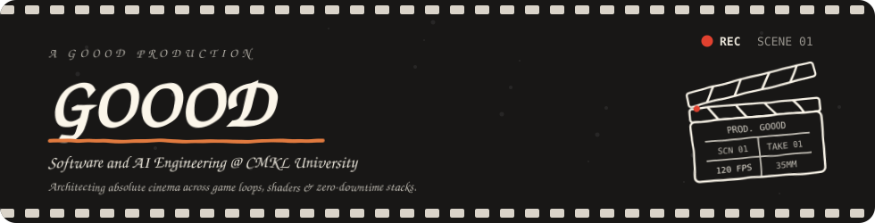
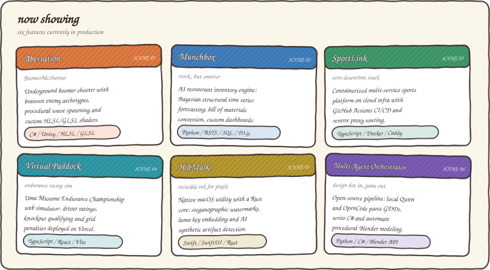
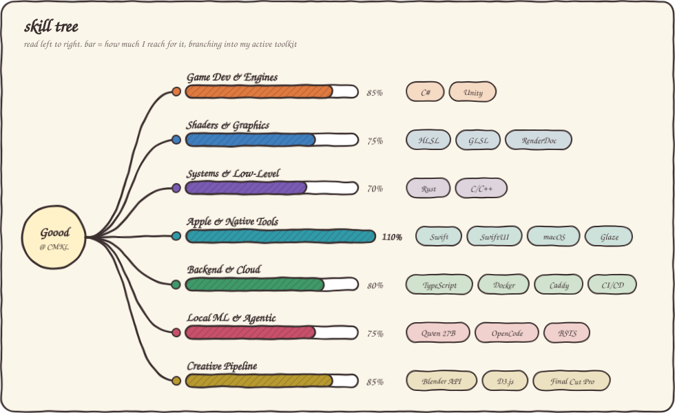
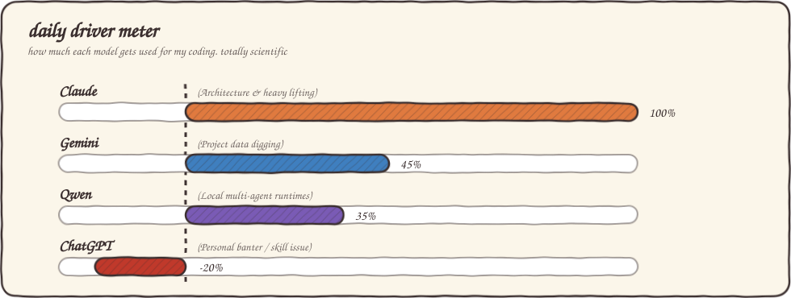

Hi, I'm Goood. I study Software and AI Engineering at **CMKL University**, and I build graphics pipelines, low-level game mechanics, containerized platforms, and multi-agent game systems.

## Now showing

## The skill tree

## The vibe and engineering lore

- **Absolute cinema execution:** I treat software architecture like a Christopher Nolan storyboard. Every commit carries narrative weight, every shader pass is framed for maximum impact, and the terminal output plays like an opening sequence.
- **Aspirational video editor turned Claude intern coach:** Set out to spend my days color grading timelines and cutting dynamic reels in Final Cut Pro, but somehow ended up full-time prompt wrangling, reviewing diffs, and coaching Claude through complex repos.
- **Conventional commits purist:** `fix:` and `feat:` are not suggestions, they are scripture. Clean Docker bridge networks, spotless Git trees, zero unreviewed merges.
- **Apple Silicon terminal gremlin:** I live inside macOS Unix shells with `uv`, custom shell scripts, and local LLM toolchains running hot.

## Daily driver meter

*Fin. Stay for the post-credits commit.*

